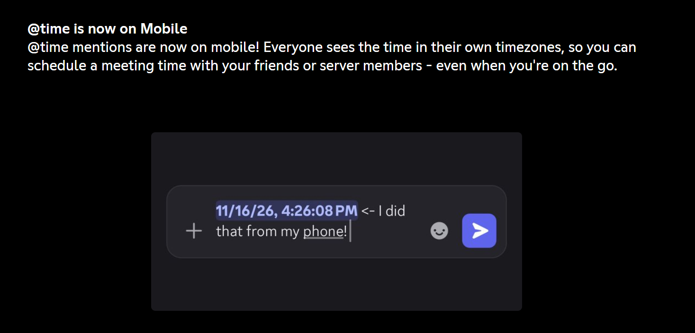

# ambertime
my discord bot repo

# DISCONTINUATION
thank you for checking out this repo!
discord has now added mobile support for the @time command (previously only accessible on desktop), which completely removes the need for this bot.
to any/all of you that came by and looked, thank you!
this repo will no longer be updated/maintained. thank you for your support

best,
amber

## anything under this line is irrelevant.

⭐ at this time, this bot only works when i have it running off of my PC. i am working on finding a hosting provider/solution to fix this. ⭐

[How to Use](howtouse.md)

[user install link](https://discord.com/oauth2/authorize?client_id=1549903975711514684&integration_type=1&scope=applications.commands)

[guild install link](https://discord.com/oauth2/authorize?client_id=1549903975711514684&integration_type=0&scope=applications.commands)

[Terms of Service](ToS.md)

[Privacy Policy](Privacy.md)

